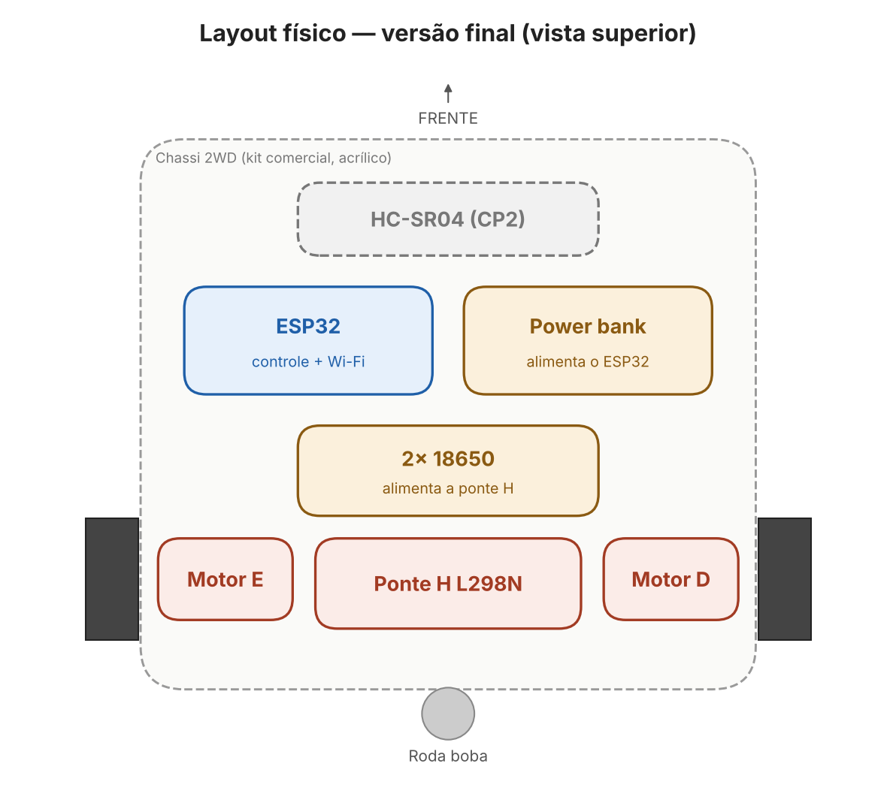

# Projeto mecânico

## Chassi utilizado

Usamos o **Kit Chassi 2WD Robô para Arduino** (comercial, em acrílico), que já inclui os dois motores DC TT, as duas rodas e a roda boba. Por isso não houve modelagem 3D nem impressão de chassi próprio (decisão D7 em [docs/requisitos-e-planejamento.md](../docs/requisitos-e-planejamento.md#7-decisões-de-projeto)).

Link do kit: ver [Organização/custos_carrinho_2wd.xlsx](../Organização/custos_carrinho_2wd.xlsx).

## Adaptações feitas no chassi comercial

| Adaptação | Motivo |
|---|---|
| ESP32 no lugar do Arduino previsto na proposta | Troca de Bluetooth para Wi-Fi (D1); o ESP32 ocupa menos espaço e dispensa o módulo Bluetooth |
| Duas fontes no chassi: suporte 2× 18650 no centro e power bank para o ESP32 | Alimentação separada entre motores e lógica (D6), com o peso concentrado no centro |
| Ponte H L298N perto dos motores, na parte de trás | Fios de potência curtos |
| Sensor HC-SR04 na frente, com vista livre | Medir a distância na direção do movimento (CP2) |
| Cabos de sinal separados dos de potência | Evitar interferência e facilitar manutenção |

## Disposição final

Proposta inicial (Arduino + Bluetooth, 20 × 15 cm): [layout físico v1](../Hardware/v1_proposta_inicial/layout_fisico_v1.png) e croqui em [requisitos-e-planejamento.md](../docs/requisitos-e-planejamento.md#2-esboço-inicial).

## Registros da montagem

- [Montagem da eletrônica — 21/08](../Hardware/foto_montagem_21-08.jpeg)
- Carrinho finalizado: [`Evidencias/`](../Evidencias/)
