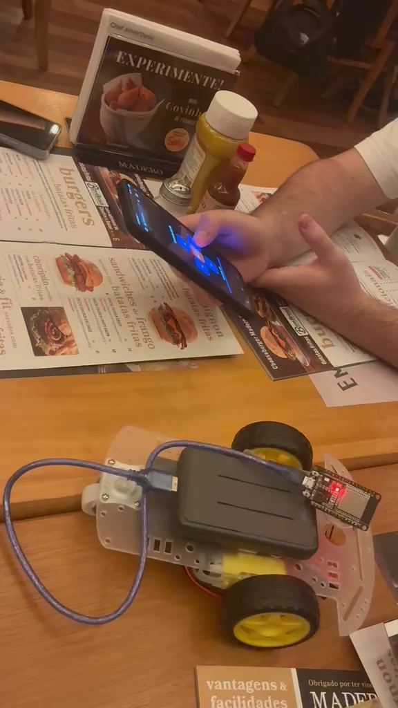

# Evidências finais

## Vídeos do funcionamento

| Vídeo | Duração | O que mostra |
|---|---:|---|
| [video_controle_celular.mp4](video_controle_celular.mp4) | 10 s | Página de controle aberta no celular e o carrinho respondendo aos toques nas setas |
| [video_funcionamento.mp4](video_funcionamento.mp4) | 26 s | Carrinho sendo dirigido pelo celular sobre a mesa: andando, fazendo curvas e parando |

Os vídeos podem ser assistidos direto no GitHub (clicar no arquivo).

## Foto do carrinho finalizado

*Quadro extraído do vídeo `video_controle_celular.mp4`: chassi 2WD com ESP32, power bank, ponte H e motores, controlado pela página web no celular.*

## Registros anteriores

- Montagem da eletrônica (21/08): [Hardware/foto_montagem_21-08.jpeg](../Hardware/foto_montagem_21-08.jpeg)
