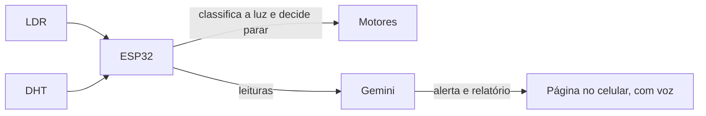

# GS — Maker Lab: robô-sensor de estação (ForaDoPico)

## Contexto (CitizenTech)

##LINK DO VIDEO: https://youtu.be/lqZVOnWQeUQ

O **ForaDoPico** é a proposta do nosso grupo para a Global Solution: uma plataforma de escala presencial inteligente para trabalhadores CLT que usam trem e metrô na Grande São Paulo. O RH informa quantas pessoas precisa no escritório em cada dia, e o app monta a escala fugindo dos horários de pico, que são os mais lotados.

O problema é a lotação no pico, que gera desconforto e insegurança para quem depende do transporte sobre trilhos.

## Papel do robô no produto

O carrinho funciona como um **robô-sensor de estação**: ele faz a ronda em uma plataforma e mede as condições do ambiente.

- **Iluminação (LDR):** identifica trechos escuros da plataforma, ligados à segurança dos passageiros.
- **Temperatura e umidade (DHT):** indicam o conforto térmico do local.
- **IA (Gemini):** transforma as leituras em um alerta curto e em um relatório da ronda para a equipe da estação, citando a temperatura e a umidade medidas.

**Limitação importante:** o robô **não conta pessoas**. Temperatura e umidade altas podem acompanhar uma plataforma cheia, mas essa relação é uma **hipótese a validar**, não uma medida de lotação. A previsão de lotação do produto vem dos outros componentes do grupo (dados do Metrô e visão computacional).

## Estrutura da pasta

```
GLOBAL SOLUTION/
├── README.md
├── gs_carrinho_etapa3/
│   ├── gs_carrinho_etapa3.ino   código principal do carrinho
│   └── secrets_exemplo.h        modelo de configuração (o secrets.h real não vai ao GitHub)
└── teste_sensores/
    └── teste_sensores.ino       teste isolado dos sensores LDR e DHT
```

## Componentes

| Item | Função |
|---|---|
| ESP32 (Dev Module) | Controle, Wi-Fi, servidor web e chamadas de rede |
| Chassi 2WD com 2 motores DC | Locomoção |
| Ponte H L298N | Aciona os motores |
| Módulo LDR (saída analógica AO) | Mede a iluminação |
| Sensor DHT11 (módulo de 3 pinos) | Mede temperatura e umidade |
| Protoboard e jumpers | Ligações e distribuição de 3V3 e GND |
| Pilhas | Alimentação dos motores |

### Ligações

| ESP32 | Ligado a |
|---|---|
| GPIO 23, 22, 18, 19 | L298N IN1, IN2, IN3, IN4 |
| GPIO 34 | LDR (AO) |
| GPIO 4 | DHT (DATA) |
| 3V3 | VCC do LDR e do DHT |
| GND | GND comum (ESP32, L298N, bateria, sensores) |

Os jumpers ENA e ENB da L298N ficam colocados, e o carrinho anda sempre na velocidade máxima.

## Como funciona



### Controle pelo celular

O ESP32 entra no Wi-Fi e serve uma página web. O celular, na mesma rede, mostra a classificação da iluminação, a porcentagem de luz, a temperatura e a umidade, e tem estes controles:

- **Setas e PARAR:** direção manual do carrinho.
- **PATRULHAR:** o carrinho anda sozinho para a frente até encontrar um trecho escuro.
- **RELATÓRIO DA RONDA (IA):** pede à IA um resumo da ronda.
- **VOZ:** o celular fala em voz alta o texto que a IA devolver.

### Autonomia e tomada de decisão

A luz é lida a cada 0,5 s (média de 20 amostras, porque o ADC do ESP32 é ruidoso). Neste módulo a leitura é **invertida**: quanto mais escuro, maior o número.

| Leitura média | Classificação |
|---|---|
| abaixo de 2500 | adequada |
| de 2500 a 3199 | baixa |
| 3200 ou mais | crítica |

- Os limites foram calibrados com leituras reais: ambiente entre cerca de 1500 e 2400, sensor coberto entre cerca de 2600 e 4095.
- Ao entrar em luz **crítica**, o carrinho **para sozinho** (inclusive no modo PATRULHAR), registra a ocorrência e pede um alerta à IA.
- Enquanto estiver no trecho escuro, o carrinho **não avança**: só recua ou gira. A trava só é liberada quando a leitura cai abaixo de 2900, uma histerese que evita oscilar na borda do limite.
- No modo manual, se o celular parar de mandar comandos, o carrinho para sozinho.

### Integração com a IA

- O ESP32 chama a API do **Gemini** por HTTPS. O prompt descreve o contexto (estação, linha, luz, temperatura, umidade e as últimas ocorrências de trecho escuro).
- Há dois pedidos: o **alerta**, automático ao entrar em trecho escuro, e o **relatório**, pelo botão. O carrinho fica parado durante a chamada, e há um intervalo mínimo de 8 s entre chamadas.
- O prompt manda a IA citar sempre a temperatura e a umidade e **não afirmar que há lotação**, só sugerir verificar o local.
- O texto volta para a página do celular e pode ser falado em voz alta.
- Sem Wi-Fi com internet, o ESP32 cria a própria rede (`Carrinho-Grupo`) e a IA fica indisponível. Se a API devolver erro, a página mostra o código e o detalhe aparece no Monitor Serial.

## Instalação e execução

1. Instale a Arduino IDE e o pacote de placas **esp32** (Espressif). Selecione **ESP32 Dev Module**.
2. Instale as bibliotecas: **DHT sensor library** e **Adafruit Unified Sensor** (Adafruit) e **ArduinoJson** (Benoit Blanchon, versão 7.x).
3. Opcional: grave `GLOBAL SOLUTION/teste_sensores/teste_sensores.ino` para conferir os sensores no Monitor Serial.
4. Abra `GLOBAL SOLUTION/gs_carrinho_etapa3/gs_carrinho_etapa3.ino`.
5. Copie `secrets_exemplo.h` para `secrets.h` na mesma pasta e preencha:
   - `WIFI_SSID` e `WIFI_PASS`: rede de **2,4 GHz** com internet;
   - `GEMINI_API_KEY`: chave criada no Google AI Studio;
   - `GEMINI_MODEL`: um modelo disponível para a sua chave (os nomes mudam com frequência; o exemplo usa `gemini-flash-latest`).
6. Grave no ESP32 e abra o Monitor Serial em 115200. O endereço da página aparece como `Conectado! Acesse...`.
7. No celular, na mesma rede, abra o endereço e use os controles descritos acima.

O `secrets.h` está no `.gitignore` e **nunca deve ser enviado ao GitHub**.

## Testes realizados

- Leitura do LDR e do DHT no Monitor Serial.
- Classificação da luz com o sensor descoberto, coberto e com o flash do celular.
- Parada automática do carrinho ao cobrir o sensor, com o aviso na página.
- Geração de alerta e relatório pela IA, citando temperatura e umidade.
- Falhas encontradas nos testes: modelo indisponível para a chave (erro 404), resolvido trocando o `GEMINI_MODEL`; alta demanda na API (erro 503), que é temporária e passa ao repetir o pedido; e rede sem internet, que cai no plano B com rede própria.

## Limitações

- O robô não conta pessoas, e a relação entre temperatura/umidade e lotação é uma hipótese.
- O carrinho anda sempre na velocidade máxima, porque o PWM está desligado.
- A conexão com a IA não valida o certificado do servidor (simplificação para o projeto escolar).
- Os limites de luz foram calibrados para o ambiente e o módulo LDR usados nos testes e podem precisar de ajuste em outro local.

## Integrantes

| Integrante | RM |
|---|---|
| João Saborido | 98184 |
| Matheus Haruo | 97663 |
| Pedro Guerra | 99526 |
| Victor Wittner | 98667 |
