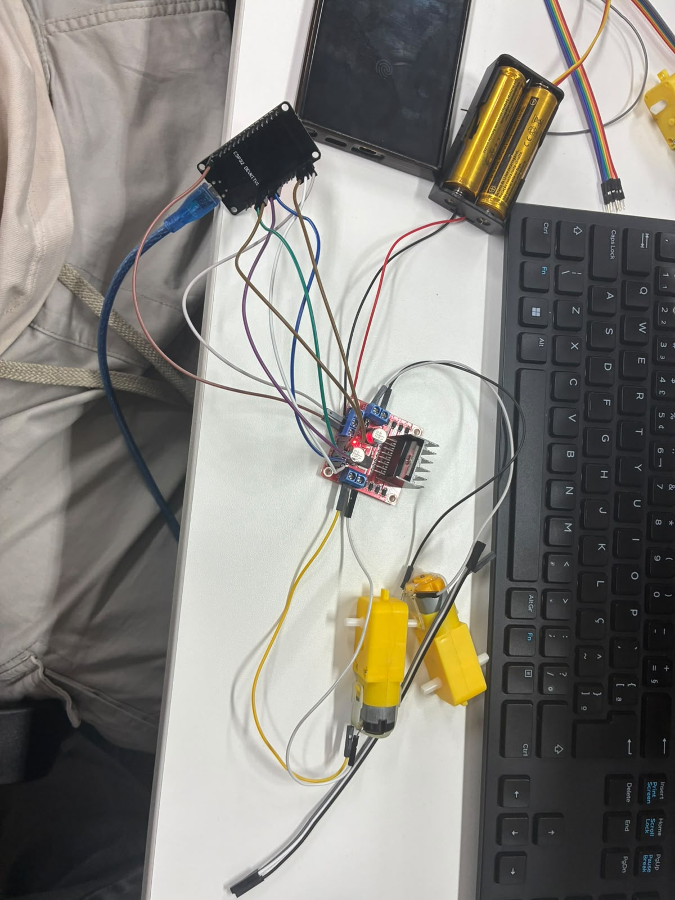

# Carrinho 2WD controlado por Wi-Fi — CP1 Maker Lab

**FIAP · Turma 4ESPW**

| Integrante | RM |
|---|---|
| João Saborido | 98184 |
| Matheus Haruo | 97663 |
| Pedro Guerra | 99526 |
| Victor Wittner | 98667 |



*Montagem do conjunto ESP32 + ponte H L298N + motores (21/08). As fotos e o vídeo do carrinho finalizado estão em [`Evidencias/`](Evidencias/).*

---

## Objetivo

Construir um carrinho de duas rodas motrizes (2WD) que possa ser dirigido pelo celular, sem fio e sem instalar aplicativo, com um sensor ultrassônico na frente para perceber obstáculos.

## Descrição

O carrinho usa um **ESP32** como controlador. Ele cria a própria rede Wi-Fi (`Carrinho-Grupo`) e hospeda uma página de controle. O celular entra nessa rede, abre `http://192.168.4.1` e passa a ter um controle com setas na tela. Cada toque é enviado ao ESP32, que aciona os dois motores DC por meio de uma **ponte H L298N**. Os motores são alimentados por duas baterias 18650, separadas da alimentação do ESP32.

O projeto começou com **Arduino + módulo Bluetooth**. Como todos os integrantes usam iPhone, que não se comunica com módulos Bluetooth clássicos, trocamos para o ESP32 com Wi-Fi. A troca e as outras decisões estão em [Decisões e evolução](docs/requisitos-e-planejamento.md#7-decisões-de-projeto).

## Principais funcionalidades

- Controle pelo navegador do celular (iPhone ou Android), sem app, pela rede Wi-Fi criada pelo próprio carrinho.
- Movimento para frente, para trás e curvas para a esquerda e direita (giro no próprio eixo).
- Movimento contínuo enquanto o botão está pressionado; ao soltar, o carrinho para.
- **Parada de segurança:** se a conexão cair ou o ESP32 ficar 600 ms sem comando, os motores desligam sozinhos.
- Botão **PARAR** dedicado.
- Sensor ultrassônico HC-SR04 montado na frente; a leitura e a reação a obstáculos estão sendo feitas no CP2 com TinyML (ver [`CP2/`](CP2/)).

## Organização do repositório

```text
CP1-MakerLab/
├── README.md                         ← esta página
├── docs/
│   ├── requisitos-e-planejamento.md  ← requisitos, esboço inicial, MVP, MoSCoW, backlog, Kanban, decisões e evolução
│   ├── hardware.md                   ← componentes, ligações, alimentação e fotos
│   ├── software.md                   ← como o programa funciona
│   └── testes.md                     ← testes, problemas, correções e resultado final
├── SRC/CodigoCarrinho/
│   └── CodigoCarrinho.ino            ← código-fonte completo do CP1 (ESP32)
├── Hardware/
│   ├── diagrama_ligacoes.png         ← esquema de ligações da versão final
│   ├── layout_fisico.png             ← disposição dos componentes no chassi
│   ├── foto_montagem_21-08.jpeg      ← registro da montagem
│   └── v1_proposta_inicial/          ← diagramas da proposta inicial (Arduino + Bluetooth)
├── CAD/                              ← projeto mecânico (chassi comercial e adaptações)
├── Organização/                      ← planilha de custos dos componentes
├── Evidencias/                       ← fotos e vídeos do carrinho finalizado
└── CP2/                              ← evolução com TinyML (Edge Impulse)
```

## Documentação por tema

| Tema | Onde está |
|---|---|
| Requisitos, esboço inicial, MVP, MoSCoW, backlog, dependências, Kanban | [docs/requisitos-e-planejamento.md](docs/requisitos-e-planejamento.md) |
| Decisões de projeto e evolução | [docs/requisitos-e-planejamento.md#7-decisões-de-projeto](docs/requisitos-e-planejamento.md#7-decisões-de-projeto) |
| Projeto mecânico | [CAD/README.md](CAD/README.md) |
| Hardware e eletrônica | [docs/hardware.md](docs/hardware.md) |
| Software | [docs/software.md](docs/software.md) |
| Testes e resultados | [docs/testes.md](docs/testes.md) |
| Evidências finais | [Evidencias/](Evidencias/) |
| Custos | [Organização/](Organização/) |

## Como usar

1. Abrir `SRC/CodigoCarrinho/CodigoCarrinho.ino` na Arduino IDE com o pacote **esp32** (Espressif) instalado e a placa **ESP32 Dev Module** selecionada.
2. Gravar no ESP32 pelo cabo USB.
3. Ligar as baterias da ponte H e alimentar o ESP32.
4. No celular, conectar na rede **Carrinho-Grupo** (senha `12345678`).
5. Abrir `http://192.168.4.1` no navegador e usar as setas.
