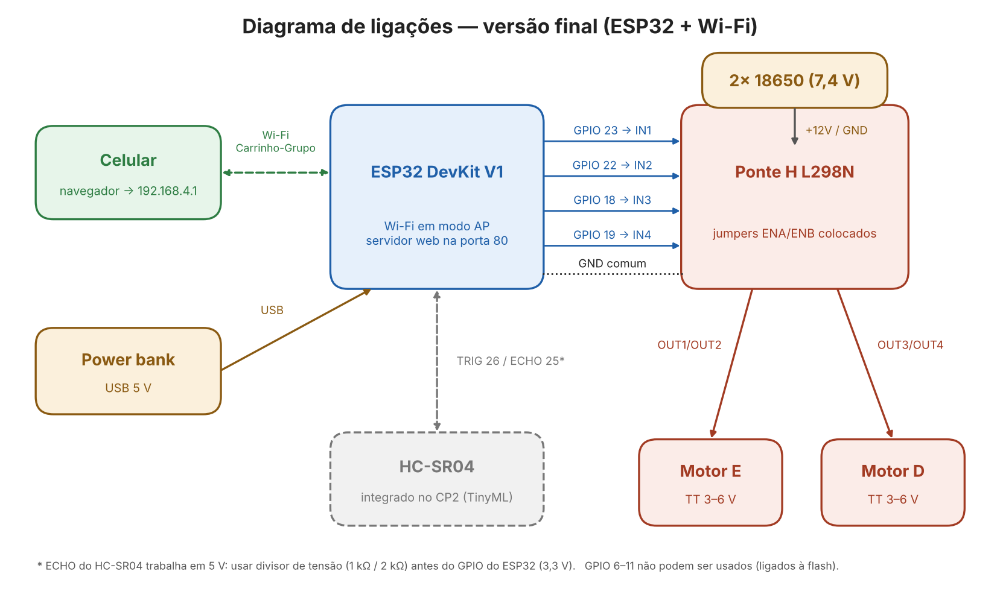
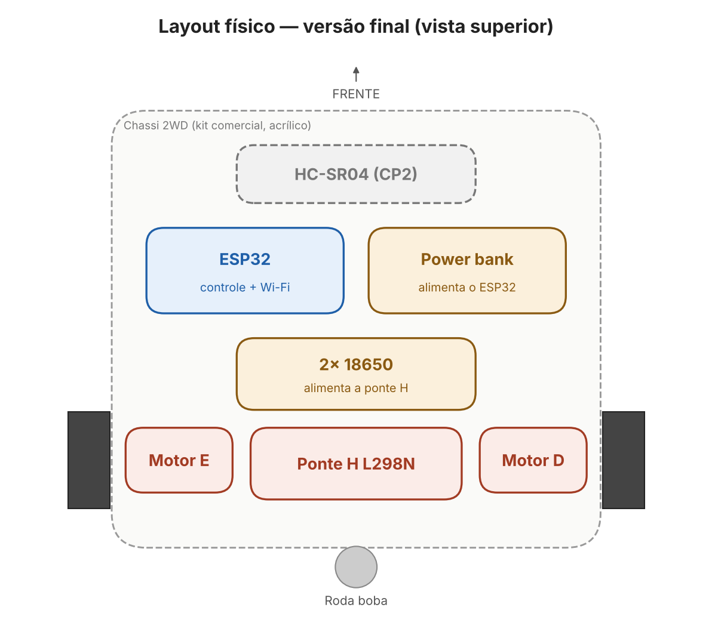
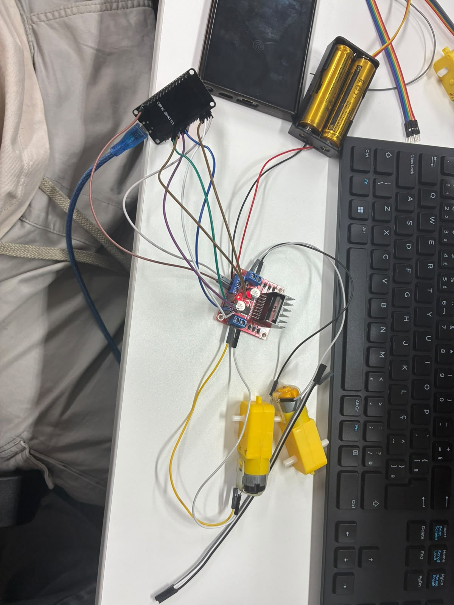

# Hardware e eletrônica

## 1. Lista de componentes

| Componente | Modelo | Qtd | Função |
|---|---|---:|---|
| Microcontrolador | ESP32 DevKit V1 (30 pinos, Wi-Fi + Bluetooth) | 1 | Controle do carrinho e servidor web do controle |
| Ponte H | Driver L298N (dupla) | 1 | Aciona e inverte o sentido dos dois motores |
| Motores | Motor DC TT com caixa de redução (3–6 V) | 2 | Tração |
| Rodas | Roda do kit 2WD | 2 | Transmissão do movimento |
| Roda boba | Rodízio do kit 2WD | 1 | Apoio e equilíbrio |
| Chassi | Kit chassi 2WD em acrílico | 1 | Estrutura |
| Sensor | Ultrassônico HC-SR04 | 1 | Medição de distância (usado no CP2) |
| Bateria dos motores | 2× célula 18650 em suporte série (≈7,4 V) | 1 | Alimentação da ponte H / motores |
| Bateria da lógica | Power bank USB 5 V | 1 | Alimentação do ESP32 |
| Fios | Jumpers M/F e F/F 20 cm | 1 kit de cada | Ligações |

Preços e links de compra: [Organização/custos_carrinho_2wd.xlsx](../Organização/custos_carrinho_2wd.xlsx).

## 2. Microcontrolador — ESP32

Escolhido no lugar do Arduino porque já tem **Wi-Fi integrado** (decisão D1 em [requisitos-e-planejamento.md](requisitos-e-planejamento.md#7-decisões-de-projeto)). Trabalha em **3,3 V** nos pinos de sinal, o que a L298N aceita como nível alto nas entradas IN.

Cuidados que tivemos:
- **GPIO 6 a 11 não podem ser usados**: estão ligados à memória flash interna.
- Entradas do ESP32 não toleram 5 V: o ECHO do HC-SR04 precisa de divisor de tensão.

## 3. Motores e ponte H

| Sinal | GPIO do ESP32 | Função |
|---|---:|---|
| IN1 | 23 | Motor esquerdo — sentido A |
| IN2 | 22 | Motor esquerdo — sentido B |
| IN3 | 18 | Motor direito — sentido A |
| IN4 | 19 | Motor direito — sentido B |
| ENA / ENB | — | Jumpers da L298N colocados (motores sempre habilitados) |
| GND | GND | Terra comum ESP32 ↔ L298N |

Tabela verdade usada por motor:

| IN_a | IN_b | Motor |
|:---:|:---:|---|
| HIGH | LOW | Frente |
| LOW | HIGH | Trás |
| LOW | LOW | Parado |

As curvas são feitas girando uma roda para frente e a outra para trás (giro no próprio eixo).

## 4. Alimentação

- **Motores:** suporte com 2× 18650 → entrada +12V/GND da L298N → saídas OUT1–OUT4 → motores.
- **ESP32:** power bank pela porta USB.
- **Terra comum:** o GND do ESP32 é ligado ao GND da L298N; sem isso, os sinais IN não têm referência.

Separar as fontes evita que a queda de tensão na partida dos motores reinicie o ESP32 e derrube a rede Wi-Fi.

## 5. Sensor

**HC-SR04** (ultrassônico, 2 cm a ~4 m), montado na frente do chassi. No CP1 ele faz parte da montagem; a leitura e o uso da distância estão sendo feitos no CP2. Pinos previstos no firmware do CP2 (ainda em confirmação no carrinho):

| Sinal | GPIO do ESP32 |
|---|---:|
| TRIG | 26 |
| ECHO | 25 (com divisor 1 kΩ / 2 kΩ, 5 V → 3,3 V) |
| VCC / GND | 5 V / GND |

## 6. Tecnologia de comunicação

**Wi-Fi 2,4 GHz**, com o ESP32 em modo **Access Point**:

| Item | Valor |
|---|---|
| Rede (SSID) | `Carrinho-Grupo` |
| Senha | `12345678` |
| Endereço do controle | `http://192.168.4.1` |
| Protocolo | HTTP — rotas `/`, `/cmd?d=` e `/vel?v=` |

A proposta inicial usava Bluetooth; a troca está explicada na decisão D1.

## 7. Diagramas

**Ligações (versão final):**

**Disposição no chassi (versão final):**

Versões da proposta inicial (Arduino + Bluetooth): [`Hardware/v1_proposta_inicial/`](../Hardware/v1_proposta_inicial/).

## 8. Fotos da montagem

*21/08 — primeira ligação completa: ESP32 DevKit V1, L298N, suporte com 2× 18650 e os dois motores TT, antes de fixar no chassi.*

Fotos do carrinho finalizado: [`Evidencias/`](../Evidencias/).
